<div align="center">


# Chhal Jbt ? · شحال جبت؟

**Le calculateur de moyenne du Bac marocain : examen régional et examen national.**
Choisis ton examen, ta filière, entre tes notes… et obtiens ta moyenne en quelques secondes.


</div>

<p align="center">
  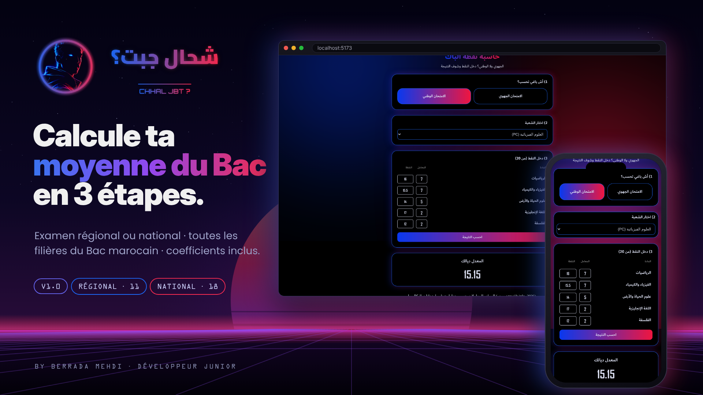
</p>

---

## Sommaire

- [Le projet](#le-projet)
- [Démo](#démo)
- [Fonctionnalités](#fonctionnalités)
- [Parcours utilisateur](#parcours-utilisateur)
- [La logique de calcul](#la-logique-de-calcul)
- [Filières et coefficients](#filières-et-coefficients)
- [Stack technique](#stack-technique)
- [Architecture](#architecture)
- [Structure du projet](#structure-du-projet)
- [Installation](#installation)
- [Limites connues de la V1](#limites-connues-de-la-v1)
- [Feuille de route](#feuille-de-route)
- [Auteur](#auteur)

---

## Le projet

Après chaque examen, tous les bacheliers marocains se posent la même question : **« شحال جبت؟ »** (*combien t'as eu ?*).
Le calcul paraît simple, mais chaque filière a ses propres matières et ses propres coefficients, aussi bien à l'**examen régional** (1ʳᵉ année Bac) qu'à l'**examen national** (2ᵉ année Bac).

**Chhal Jbt ?** règle ça : l'application connaît les matières et les coefficients de **29 filières** (11 au régional, 18 au national). Il suffit d'entrer ses notes.

L'interface est en **arabe / darija** (sens RTL), avec une identité visuelle néon bleu ↔ rouge.

> **Version 1.0** : c'est la première version publique. D'autres mises à jour suivront.

---

## Démo

<p align="center">
  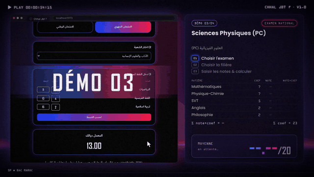
</p>

<p align="center"><i>Examen national · Sciences Physiques (PC) : 5 notes saisies → moyenne <b>15.15</b></i></p>

---

## Fonctionnalités

| | Fonctionnalité | Détail |
|:-:|---|---|
| 🎯 | **Deux examens** | Bascule entre `الامتحان الوطني` (national) et `الامتحان الجهوي` (régional) en un clic |
| 📚 | **29 filières** | 11 au régional, 18 au national : sciences, lettres, économie, technique, enseignement originel, arts appliqués, bac pro |
| 🧮 | **Coefficients intégrés** | Chaque matière affiche son coefficient à côté du champ de note |
| ♻️ | **Formulaire dynamique** | Le tableau des matières se reconstruit à chaque changement d'examen ou de filière, et les notes sont réinitialisées |
| ⚡ | **Résultat instantané** | Moyenne pondérée affichée avec 2 décimales |
| 🌙 | **Design néon** | Fond noir, halos bleu/rouge, cartes lumineuses, typographies Cairo + Orbitron |

---

## Parcours utilisateur

<p align="center">
  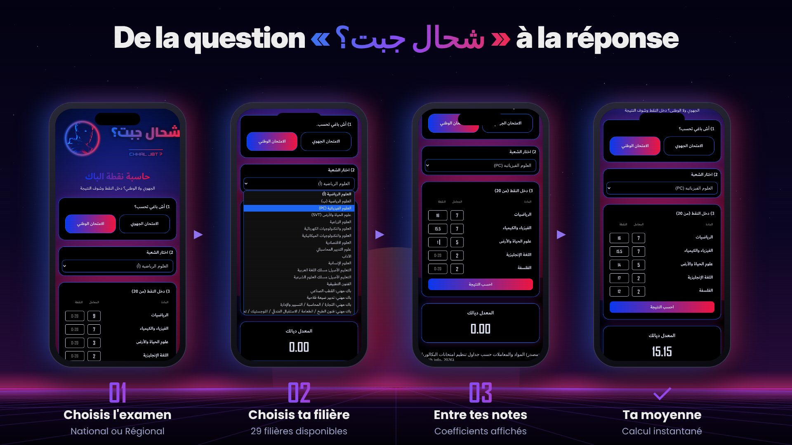
</p>

### 1 · Choisir l'examen · `1) أش باغي تحسب؟`
Deux boutons. Le bouton actif passe en dégradé bleu → rouge. Par défaut, l'application s'ouvre sur l'**examen régional**.

<p align="center">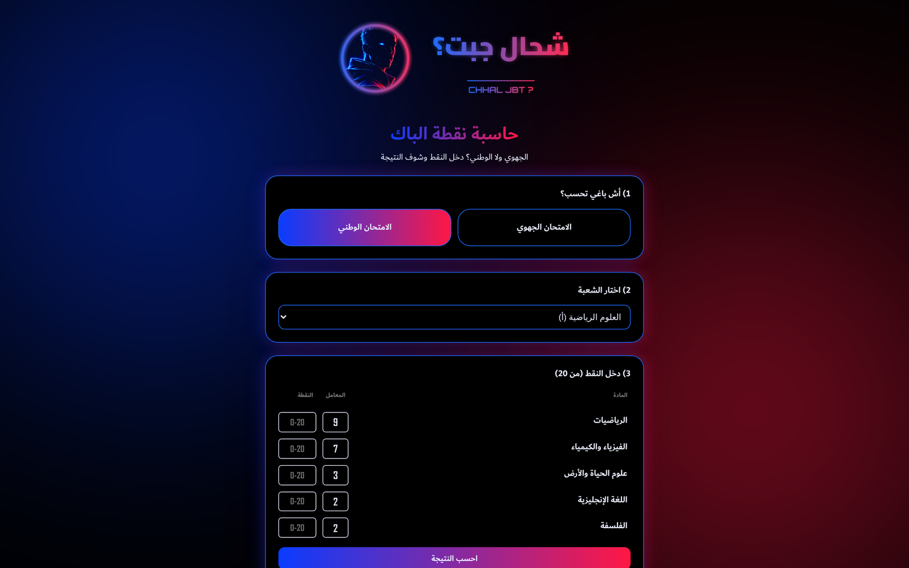</p>

### 2 · Choisir la filière · `2) اختار الشعبة`
La liste déroulante s'adapte à l'examen choisi : 11 filières pour le régional, 18 pour le national. Quand on change d'examen, la première filière de la liste est sélectionnée automatiquement.

<p align="center">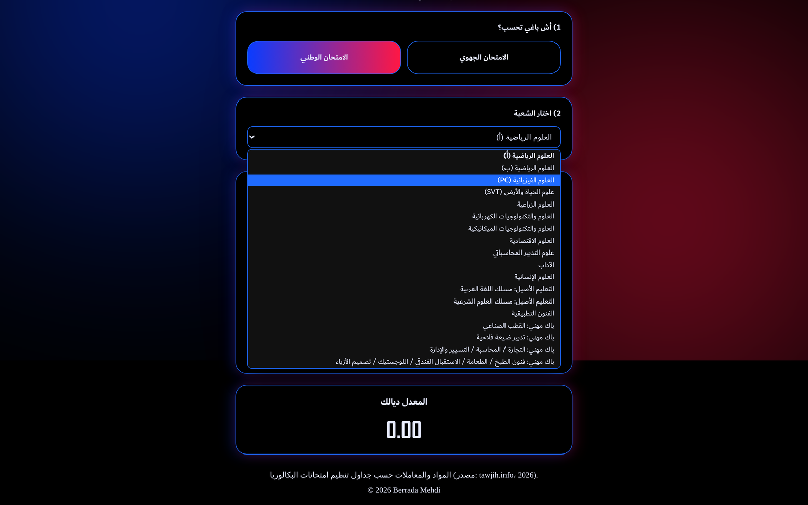</p>

### 3 · Saisir les notes · `3) دخل النقط (من 20)`
Un tableau **Matière · Coefficient · Note** est généré pour la filière. Chaque champ attend une note sur 20.

<p align="center">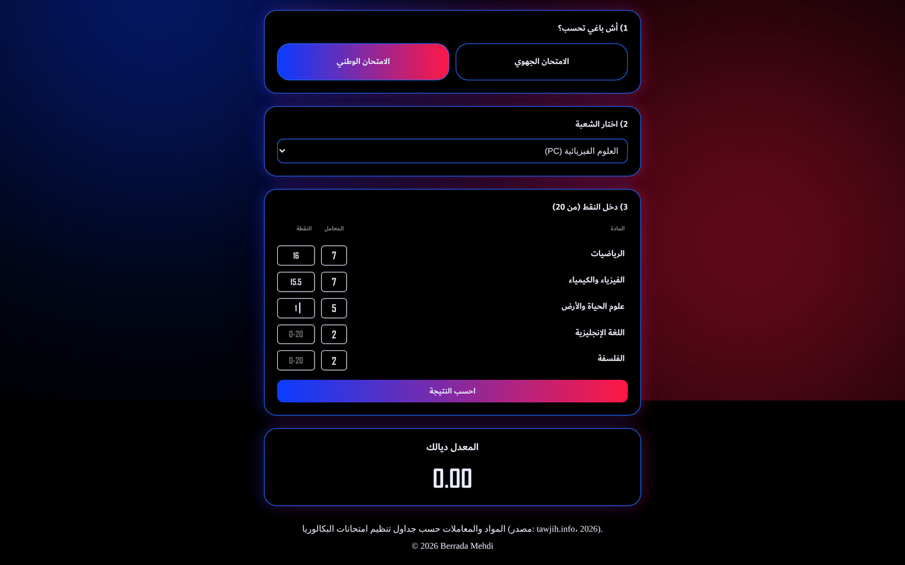</p>

### 4 · Résultat · `المعدل ديالك`
Un clic sur **احسب النتيجة** et la moyenne s'affiche.

<p align="center">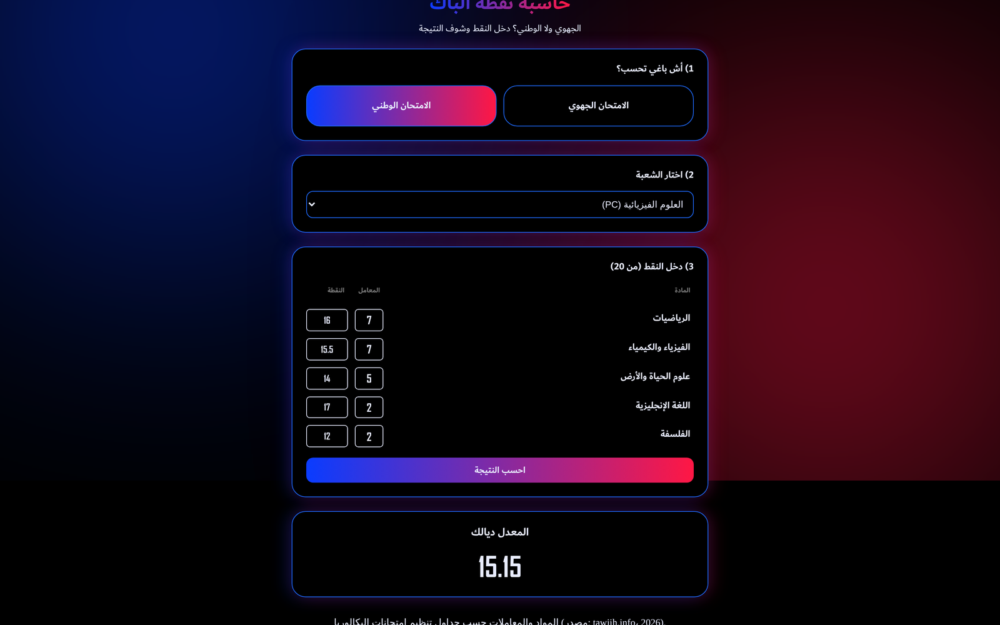</p>

### Sur mobile

<p align="center">
  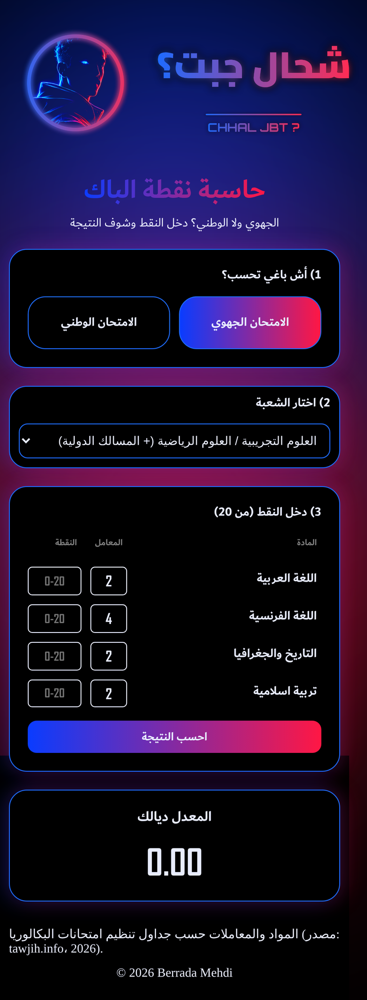
  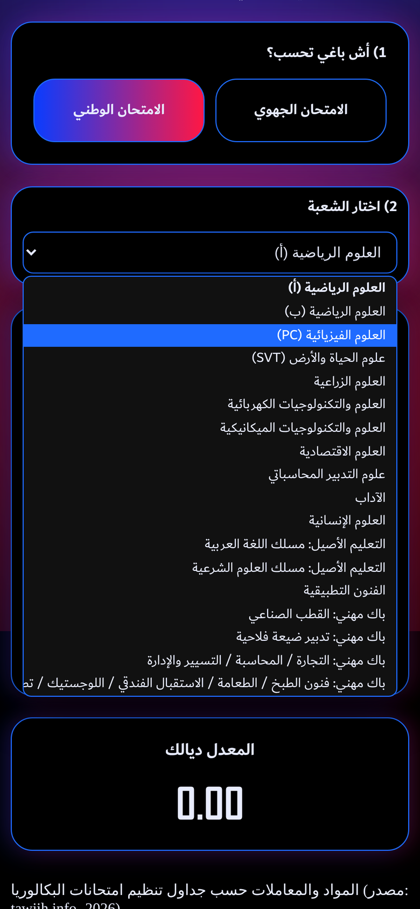
  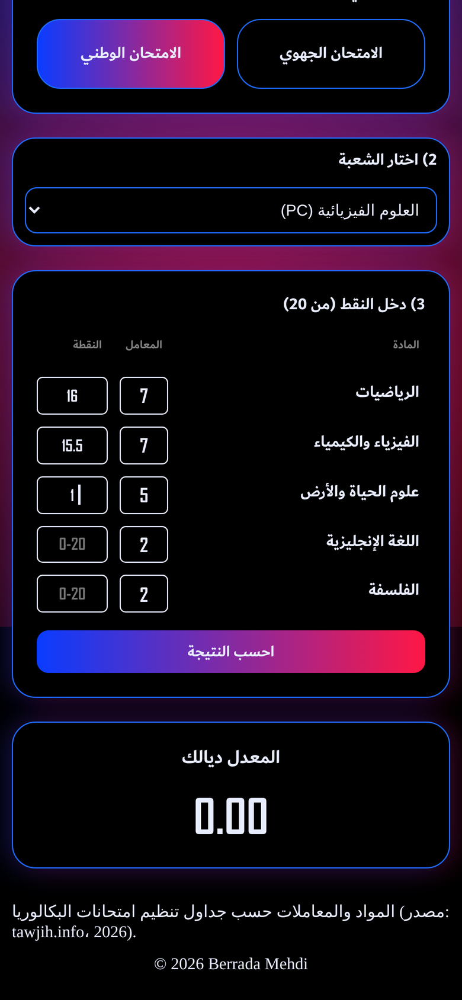
  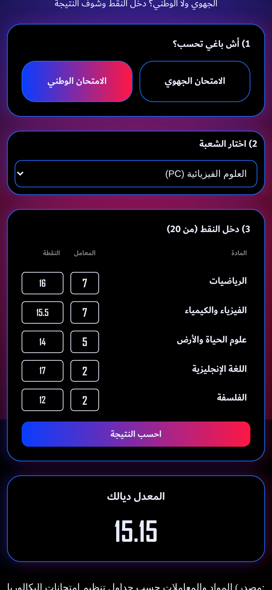
</p>

---

## La logique de calcul

La moyenne est une **moyenne pondérée** :

$$
\text{Moyenne} = \frac{\sum (\text{note} \times \text{coefficient})}{\sum \text{coefficients}}
$$

Dans le code (`GradesForm.jsx › handleResult`) :

```js
coeffs_list.map(element => {
  sum += Number.parseInt(element.value) * Number.parseFloat(values[element.name]) // note × coef
  div += Number.parseInt(element.value)                                          // Σ coef
})
setResult(sum / div)
```

Puis `ResultSelector` affiche `result.toFixed(2)` (ou `0` si le résultat n'est pas un nombre).

### Exemples vérifiés

| Examen | Filière | Notes (coef) | Calcul | Moyenne |
|---|---|---|---|:---:|
| Régional | Sciences Exp. / Sciences Maths | Arabe 14 (2) · Français 12.5 (4) · Histoire-Géo 15 (2) · Éd. islamique 16 (2) | 140 ÷ 10 | **14.00** |
| Régional | Lettres et Sciences Humaines | Maths 9 (1) · Français 13 (4) · Éd. islamique 15 (2) | 91 ÷ 7 | **13.00** |
| National | Sciences Physiques (PC) | Maths 16 (7) · PC 15.5 (7) · SVT 14 (5) · Anglais 17 (2) · Philo 12 (2) | 348.5 ÷ 23 | **15.15** |
| National | Sciences Économiques | Maths 13 (4) · Compta 15 (4) · Éco. générale 14 (6) · Éco. orga. 16 (3) · Anglais 15 (2) · Philo 11 (2) | 296 ÷ 21 | **14.10** |

---

## Filières et coefficients

Données centralisées dans `src/provider/Data.jsx` (source : tableaux d'organisation des examens du Bac, tawjih.info, 2026).

<details>
<summary><b>Voir les 29 filières et leurs coefficients</b></summary>

#### Examen régional

| الشعبة | المواد والمعاملات | Σ coef |
|---|---|:---:|
| العلوم التجريبية / العلوم الرياضية (+ المسالك الدولية) | اللغة العربية (2) · اللغة الفرنسية (4) · التاريخ والجغرافيا (2) · تربية اسلامية (2) | 10 |
| الآداب والعلوم الإنسانية | الرياضيات (1) · اللغة الفرنسية (4) · تربية اسلامية (2) | 7 |
| علوم الاقتصاد والتدبير | اللغة العربية (2) · اللغة الفرنسية (3) · التاريخ والجغرافيا (3) · تربية اسلامية (2) | 10 |
| العلوم والتكنولوجيات (كهربائية / ميكانيكية) | اللغة العربية (2) · اللغة الفرنسية (4) · تربية اسلامية (2) | 8 |
| الفنون التطبيقية | اللغة العربية (2) · اللغة الفرنسية (4) · الرياضيات (2) · تربية اسلامية (2) | 10 |
| التعليم الأصيل - مسلك اللغة العربية | اللغة العربية (3) · اللغة الفرنسية (3) · الرياضيات (1) | 7 |
| التعليم الأصيل - مسلك العلوم الشرعية | اللغة الفرنسية (3) · التاريخ والجغرافيا (2) · علوم اللغة (2) · الفرائض والتوقيت (2) | 9 |
| باك مهني - القطب الصناعي | اللغة والثقافة العربية (2) · اللغة الفرنسية (4) · تربية اسلامية (2) | 8 |
| باك مهني - تدبير ضيعة فلاحية | اللغة والثقافة العربية (2) · اللغة الفرنسية (4) · تربية اسلامية (2) | 8 |
| باك مهني - التجارة / المحاسبة / التسيير والإدارة | اللغة والثقافة العربية (2) · اللغة الفرنسية (3) · تربية اسلامية (2) | 7 |
| باك مهني - فنون الطبخ / الطعامة / الاستقبال الفندقي / اللوجستيك / تصميم الأزياء | اللغة والثقافة العربية (4) · اللغة الفرنسية (4) · الرياضيات (2) · تربية اسلامية (2) | 12 |

#### Examen national

| الشعبة | المواد والمعاملات | Σ coef |
|---|---|:---:|
| العلوم الرياضية (أ) | الرياضيات (9) · الفيزياء والكيمياء (7) · علوم الحياة والأرض (3) · اللغة الإنجليزية (2) · الفلسفة (2) | 23 |
| العلوم الرياضية (ب) | الرياضيات (9) · الفيزياء والكيمياء (7) · علوم المهندس (3) · اللغة الإنجليزية (2) · الفلسفة (2) | 23 |
| العلوم الفيزيائية (PC) | الرياضيات (7) · الفيزياء والكيمياء (7) · علوم الحياة والأرض (5) · اللغة الإنجليزية (2) · الفلسفة (2) | 23 |
| علوم الحياة والأرض (SVT) | الرياضيات (7) · الفيزياء والكيمياء (5) · علوم الحياة والأرض (7) · اللغة الإنجليزية (2) · الفلسفة (2) | 23 |
| العلوم الزراعية | الرياضيات (7) · الفيزياء والكيمياء (5) · علوم الحياة والأرض (5) · علوم نباتية وحيوانية (5) · اللغة الإنجليزية (2) · الفلسفة (2) | 26 |
| العلوم والتكنولوجيات الكهربائية | الرياضيات (7) · الفيزياء والكيمياء (5) · علوم المهندس (8) · اللغة الإنجليزية (2) · الفلسفة (2) | 24 |
| العلوم والتكنولوجيات الميكانيكية | الرياضيات (7) · الفيزياء والكيمياء (5) · علوم المهندس (8) · اللغة الإنجليزية (2) · الفلسفة (2) | 24 |
| العلوم الاقتصادية | الرياضيات (4) · المحاسبة والرياضيات المالية (4) · الاقتصاد العام والإحصاء (6) · الاقتصاد والتنظيم الإداري للمقاولات (3) · اللغة الإنجليزية (2) · الفلسفة (2) | 21 |
| علوم التدبير المحاسباتي | الرياضيات (4) · المحاسبة والرياضيات المالية (6) · الاقتصاد العام والإحصاء (3) · الاقتصاد والتنظيم الإداري للمقاولات (6) · اللغة الإنجليزية (2) · الفلسفة (2) | 23 |
| الآداب | التاريخ والجغرافيا (3) · اللغة العربية (4) · اللغة الإنجليزية (4) · الفلسفة (3) | 14 |
| العلوم الإنسانية | التاريخ والجغرافيا (4) · الفلسفة (4) · اللغة العربية (3) · اللغة الإنجليزية (3) | 14 |
| التعليم الأصيل: مسلك اللغة العربية | علوم اللغة (4) · الآداب (5) · التفسير والحديث (4) · اللغة الإنجليزية (2) · الفلسفة (2) | 17 |
| التعليم الأصيل: مسلك العلوم الشرعية | الفقه والأصول (5) · الآداب (4) · التفسير والحديث (5) · اللغة الإنجليزية (2) · الفلسفة (2) | 18 |
| الفنون التطبيقية | فن تصميم التواصل والوسائط المتعددة (8) · فن تصميم المحيط (5) · فن تصميم المنتوج (5) · اللغة الإنجليزية (2) · الفلسفة (2) | 22 |
| باك مهني: القطب الصناعي | الرياضيات (7) · الفيزياء والكيمياء (5) · مواد التخصص (10) · اللغة الإنجليزية (2) · الفلسفة (2) | 26 |
| باك مهني: تدبير ضيعة فلاحية | الرياضيات (7) · الفيزياء والكيمياء (5) · علوم الحياة والأرض (5) · مواد التخصص (10) · اللغة الإنجليزية (2) · الفلسفة (2) | 31 |
| باك مهني: التجارة / المحاسبة / التسيير والإدارة | الرياضيات (4) · مواد التخصص (10) · اللغة الإنجليزية (2) · الفلسفة (2) | 18 |
| باك مهني: فنون الطبخ / الطعامة / الاستقبال الفندقي / اللوجستيك / تصميم الأزياء | مواد التخصص (10) · اللغة الإنجليزية (2) · الفلسفة (2) | 14 |

</details>

---

## Stack technique

| Outil | Rôle |
|---|---|
| **React 19** | Interface en composants, `useState`, `useEffect`, `useContext` |
| **Context API** | État global partagé (`examType`, `branch`, `result`) et données des filières |
| **React Compiler** | Activé via `babel-plugin-react-compiler` (mémoïsation automatique) |
| **Vite 8** | Serveur de développement + build |
| **Oxlint** | Linting |
| **CSS3** | Un fichier CSS par composant, variables CSS, dégradés, `box-shadow` néon, RTL |
| **Google Fonts** | *Cairo* (texte arabe), *Orbitron* (chiffres) |

---

## Architecture

```text
main.jsx
└── <Data>                      ← Context Provider : examType · branch · result + données des 29 filières
    └── <App>
        └── <Home>              ← logo, en-tête, footer, halos de fond
            ├── <ExamSelector>     ← 1) choix National / Régional       → setExamType()
            ├── <BranchSelector>   ← 2) liste des filières               → setBranch()
            ├── <GradesForm>       ← 3) tableau matières/coef/notes      → setResult(sum / div)
            └── <ResultSelector>   ← affiche result.toFixed(2)
```

**Flux des données**

1. `ExamSelector` met à jour `examType` dans le contexte.
2. Un `useEffect` du provider (`Data.jsx`) remet `branch` sur la première filière de l'examen choisi.
3. `BranchSelector` affiche la liste `regional` ou `national` et met à jour `branch`.
4. `GradesForm` cherche la filière dans `regionalBranch` / `nationalBranch`, génère les lignes et stocke les notes dans un état local `values`, remis à zéro par un `useEffect` quand `branch` ou `examType` change.
5. Au clic, `handleResult` calcule la moyenne pondérée et appelle `setResult`, puis `ResultSelector` l'affiche.

---

## Structure du projet

```text
chhal jbt/
├── index.html
├── package.json
├── vite.config.js
├── docs/
│   ├── demo.gif
│   └── screenshots/              ← captures desktop, mobile et visuels de présentation
└── src/
    ├── main.jsx                  ← point d'entrée, enveloppe <App> dans <Data>
    ├── App.jsx
    ├── index.css                 ← polices + variables de couleurs (:root)
    ├── assets/                   ← logo, icônes, favicons
    ├── pages/
    │   ├── Home.jsx
    │   └── home.css
    ├── provider/
    │   └── Data.jsx              ← Context + données des filières/coefficients
    └── components/
        ├── examSelector/         ← ExamSelector.jsx + examSelector.css
        ├── branchSelector/       ← BranchSelector.jsx + branchSelector.css
        ├── gradesForm/           ← GradesForm.jsx + gradesForm.css
        └── resultSelector/       ← ResultSelector.jsx + resultSelector.css
```

---

## Installation

**Prérequis :** Node.js (version récente LTS) et npm.

```bash
# 1. Cloner le dépôt
git clone https://github.com/berradamehdi/Chhal-Jbt-React.git
cd "chhal jbt"

# 2. Installer les dépendances
npm install

# 3. Lancer en développement → http://localhost:5173
npm run dev
```

| Script | Action |
|---|---|
| `npm run dev` | Serveur de développement Vite |
| `npm run build` | Build de production dans `dist/` |
| `npm run preview` | Prévisualiser le build |
| `npm run lint` | Analyse du code avec Oxlint |

---

## Limites connues de la V1

Cette première version se concentre sur l'essentiel. Points identifiés pour les prochaines versions :

- **Validation des notes** : les champs sont de type texte. Une note hors de l'intervalle 0–20 est acceptée, et un champ vide fait afficher `0` comme résultat.
- **Virgule décimale** : `Number.parseFloat("12,5")` donne `12`. Il faut écrire `12.5` avec un point.
- **Petits écrans** : le logo a une largeur fixe de `400px`, ce qui provoque un léger défilement horizontal sous ~410px de large.
- **Résultat conservé** : la moyenne précédente reste affichée quand on change de filière, jusqu'au prochain calcul.

---

## Feuille de route

- [x] **V1.0** : examens régional et national, 29 filières, calcul de la moyenne pondérée
- [ ] Prochaines mises à jour : en cours… 🚀

---

## Auteur

<table>
<tr>
<td></td>
<td>

**Berrada Mehdi** · Développeur Junior
🟢 *Disponible pour un stage ou un emploi*

- 💬 WhatsApp : [+212 618-376675](https://wa.me/212618376675)
- ✉️ Email : [berradamehdidev@gmail.com](mailto:berradamehdidev@gmail.com)
- 💼 LinkedIn : [linkedin.com/in/mehdiberrada37](https://www.linkedin.com/in/mehdiberrada37/)
- 🐙 GitHub : [github.com/berradamehdi](https://github.com/berradamehdi)
- 𝕏 X : [x.com/berradadev](https://x.com/berradadev)

</td>
</tr>
</table>

<p align="center"><sub>© 2026 Berrada Mehdi · Fait avec React</sub></p>
